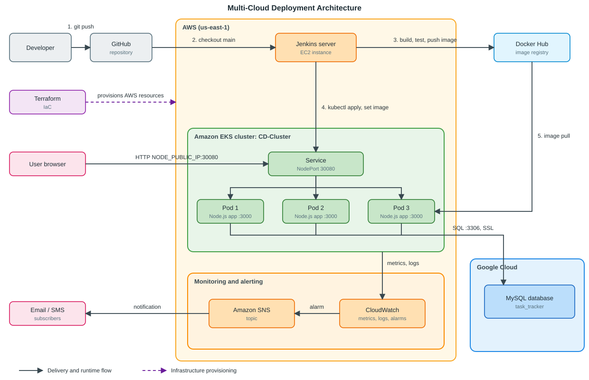

# Multi-Cloud Deployment: Three-Tier Task Tracker

A task manager built as a **three-tier web application** and deployed across **two clouds** with an automated CI/CD pipeline. The application tier runs on **Amazon EKS (AWS)**, provisioned with **Terraform**, while the data tier is a **MySQL database hosted on Google Cloud**. Builds and deployments are driven by **Jenkins**, with images stored in **Docker Hub**.

## Table of Contents

1. [Architecture](#architecture)
2. [Tech Stack](#tech-stack)
3. [Repository Structure](#repository-structure)
4. [Application Overview](#application-overview)
5. [Configuration](#configuration)
6. [Run Locally](#run-locally)
7. [Infrastructure (Terraform)](#infrastructure-terraform)
8. [Kubernetes Manifests](#kubernetes-manifests)
9. [CI/CD Pipeline (Jenkins)](#cicd-pipeline-jenkins)
10. [Verifying the Deployment](#verifying-the-deployment)
11. [Security Notes](#security-notes)
12. [Troubleshooting](#troubleshooting)

---

## Architecture



<details>
<summary>Text version of the diagram</summary>

```text
                               ┌─ AWS (us-east-1) ────────────────────────────────┐
  1. git push                  │                                  3. build, test, │
┌───────────┐    ┌──────────┐  │ 2. checkout main┌─────────────┐     push image   │    ┌─────────────┐
│ Developer │───▶│  GitHub  │──┼────────────────▶│Jenkins (EC2)│──────────────────┼───▶│ Docker Hub  │
└───────────┘    └──────────┘  │                 └──────┬──────┘                  │    └──────┬──────┘
                               │                        │                         │           │
                               │                        │                         │           │
┌───────────────┐ provisions   │                        │ 4. kubectl apply,       │           │
│   Terraform   │- - - - - - -▶│                        │    set image            │           │
└───────────────┘ AWS resources│                        │                         │           │
                               │ ┌─ EKS: CD-Cluster ────│──────────────────────┐  │           │ 5. image
                               │ │                      ▼                      │  │           │    pull
                               │ │           ┌─────────────────────┐           │  │           │
┌───────────────┐ HTTP :30080  │ │           │       Service       │           │  │           │
│ User browser  │──────────────┼─┼──────────▶│   NodePort 30080    │           │  │           │
└───────────────┘              │ │           └──────────┬──────────┘           │  │           │
                               │ │       ┌──────────────┼──────────────┐       │  │           │
                               │ │       ▼              ▼              ▼       │  │           │
                               │ │ ┌───────────┐  ┌───────────┐  ┌───────────┐ │  │           │
                               │ │ │   Pod 1   │  │   Pod 2   │  │   Pod 3   │◀┼──┼───────────┘
                               │ │ └─────┬─────┘  └─────┬─────┘  └─────┬─────┘ │  │ SQL :3306 (SSL)
                               │ │       └──────────────┴──────────────┴───────┼──┼─────┐
                               │ │                                             │  │     │
                               │ └─────────────────────────────────┬───────────┘  │     │
                               │                                   │ metrics/logs │ ┌───│──────────────┐
                               │                                   │              │ │   ▼              │
                               │ ┌─ Monitoring and alerting ───────│───────────┐  │ │ ┌──────────────┐ │
                               │ │                                 ▼           │  │ │ │MySQL database│ │
┌───────────────┐ notification │ │   ┌──────────────┐ alarm┌───────────────┐   │  │ │ │ task_tracker │ │
│  Email / SMS  │◀─────────────┼─┼───│  Amazon SNS  │◀─────│  CloudWatch   │   │  │ │ └──────────────┘ │
└───────────────┘              │ │   └──────────────┘      └───────────────┘   │  │ │                  │
                               │ │                                             │  │ │                  │
                               │ └─────────────────────────────────────────────┘  │ └─ Google Cloud ───┘
                               └──────────────────────────────────────────────────┘

──▶  delivery and runtime flow        - - ▶  infrastructure provisioning
```

</details>

**Monitoring:** EKS metrics and logs are collected by Amazon CloudWatch. When an alarm fires, it publishes to an Amazon SNS topic, which notifies the subscribed email addresses or phone numbers.

**Client access:** users open `http://<node-public-ip>:30080` in a browser. The request reaches the NodePort Service on an EKS worker node, which load-balances it across the 3 pods. The pods serve the UI (tier 1), handle API calls (tier 2), and query the database (tier 3).

### Tiers and where they run

| Tier | Responsibility | Where it runs |
|---|---|---|
| **1. Presentation** | Static HTML/CSS/JS served by Express (`public/`) | Inside the app container on EKS |
| **2. Application** | Express REST API, validation, business rules (`server.js`) | 3 replicas on Amazon EKS (AWS) |
| **3. Data** | MySQL database; the `tasks` table is created automatically on startup (`db.js`) | Google Cloud |

### Why multi-cloud

The compute tier and the data tier live on different providers, so the application is portable and the database is not tied to AWS. The app reads its database location from environment variables only, so either tier can be moved without code changes.

### Deployment flow

1. A push to `main` on GitHub is picked up by Jenkins.
2. Jenkins installs dependencies, builds the Docker image, and tags it `:<BUILD_NUMBER>` and `:latest`.
3. The image is started as a test container and must pass `GET /health`.
4. The image is pushed to Docker Hub.
5. Jenkins authenticates to AWS, connects to the `CD-Cluster` EKS cluster, and refreshes the Kubernetes Secret with the database credentials.
6. Jenkins applies the Deployment and Service, sets the new image, and waits for the rollout to complete.
7. Pods pull the image from Docker Hub and connect to the MySQL database on Google Cloud.
8. CloudWatch monitors the cluster; alarms are sent through SNS to the subscribed recipients.

## Tech Stack

| Area | Technology |
|---|---|
| Frontend | HTML, CSS, vanilla JavaScript |
| Backend | Node.js 22, Express 4 |
| Database | MySQL on Google Cloud, accessed with `mysql2` (SSL enabled) |
| Containerization | Docker (`node:22-alpine`) |
| Registry | Docker Hub |
| CI/CD | Jenkins (declarative pipeline) |
| Orchestration | Kubernetes on Amazon EKS |
| Monitoring and alerting | Amazon CloudWatch, Amazon SNS |
| Infrastructure as Code | Terraform (AWS resources) |
| Clouds | AWS (compute) and Google Cloud (database) |

## Repository Structure

```
Multi-Cloud_Deployment/
├── Dockerfile               # Container image definition
├── Jenkinsfile              # CI/CD pipeline
├── kubernetes/
│   ├── deployment.yaml      # App Deployment (3 replicas, health probes)
│   ├── service.yaml         # NodePort Service (30080 -> 3000)
│   └── secrets.yaml         # Secret template for DB credentials
├── public/                  # Tier 1: UI (index.html, style.css, app.js)
├── server.js                # Tier 2: Express API
├── db.js                    # Tier 3: MySQL access layer
├── package.json
├── .env.example             # Template for local environment variables
├── kubectl.sha256           # Checksum for the kubectl binary
└── terraform/               # AWS infrastructure (see Infrastructure section)
```

## Application Overview

REST API exposed by `server.js`:

| Method | Endpoint | Description |
|---|---|---|
| `GET` | `/api/tasks` | List all tasks |
| `POST` | `/api/tasks` | Create a task (`{ "title": "..." }`, max 140 chars) |
| `PATCH` | `/api/tasks/:id` | Toggle a task's done state |
| `DELETE` | `/api/tasks/:id` | Delete a task |
| `GET` | `/health` | Health check, returns `200 OK` |

On startup the app runs `CREATE TABLE IF NOT EXISTS tasks ...`, so no manual schema setup is needed.

## Configuration

The app is configured entirely through environment variables.

| Variable | Description |
|---|---|
| `DB_HOST` | MySQL host (Google Cloud database address) |
| `DB_PORT` | MySQL port, usually `3306` |
| `DB_USER` | Database user |
| `DB_PASSWORD` | Database password |
| `DB_NAME` | Database name (`task_tracker`) |
| `PORT` | HTTP port the app listens on (default `3000`) |

Locally these come from a `.env` file. On Kubernetes they are injected from the `three-tier-app-db-secrets` Secret.

## Run Locally

**Prerequisites:** Node.js 18+ and a MySQL database you can reach.

```bash
git clone https://github.com/Sarthaki15/Multi-Cloud_Deployment.git
cd Multi-Cloud_Deployment

cp .env.example .env        # fill in your DB credentials
npm install
npm start
```

Open <http://localhost:3000>.

With Docker:

```bash
docker build -t three-tier-app:local .
docker run -d --name task-tracker --env-file .env -p 8080:3000 three-tier-app:local
curl http://localhost:8080/health      # -> OK
```

## Infrastructure (Terraform)

The AWS resources (such as the EKS cluster and its supporting networking) are provisioned with Terraform. The database on Google Cloud is created separately.

```bash
cd terraform
terraform init
terraform plan
terraform apply
```

After the cluster exists, connect `kubectl` to it:

```bash
aws eks update-kubeconfig --name CD-Cluster --region us-east-1
```

To remove the AWS resources and avoid charges:

```bash
terraform destroy
```

> Note: the cluster name and region above match the values in the `Jenkinsfile`. If you change them in Terraform, update `EKS_CLUSTER_NAME` and `AWS_DEFAULT_REGION` in the `Jenkinsfile` as well.

## Kubernetes Manifests

| File | Purpose |
|---|---|
| `kubernetes/deployment.yaml` | Deployment `three-tier-app-deployment` with **3 replicas**, port `3000`, env loaded from the Secret, plus readiness and liveness probes on `/health` |
| `kubernetes/service.yaml` | Service of type **NodePort**: `8080 -> 3000`, exposed on node port **30080** |
| `kubernetes/secrets.yaml` | Secret `three-tier-app-db-secrets` template holding `DB_HOST`, `DB_PORT`, `DB_USER`, `DB_PASSWORD`, `DB_NAME` |

The pipeline does not apply `secrets.yaml`. It builds the Secret from a Jenkins credential instead (see below), so real credentials never need to be stored in the repository.

## CI/CD Pipeline (Jenkins)

The `Jenkinsfile` defines a declarative pipeline (30-minute timeout, no concurrent builds):

| # | Stage | What it does |
|---|---|---|
| 1 | **Git Checkout** | Clones the `main` branch from GitHub |
| 2 | **Install Dependencies** | Runs `npm ci` |
| 3 | **Build Docker Image** | Builds the image, tagged `:<BUILD_NUMBER>` and `:latest` |
| 4 | **Test Docker Image** | Runs the container with the `APP_ENV_FILE` credential and polls `/health` for up to 60 seconds; the test container is always removed afterwards |
| 5 | **Docker Hub Login and Push** | Logs in with `dockerhub-login` and pushes both tags |
| 6 | **Configure AWS and EKS** | Checks AWS identity, runs `aws eks update-kubeconfig`, lists nodes |
| 7 | **Update Kubernetes Secret** | Creates or updates `three-tier-app-db-secrets` from the `secrets-db-env` credential |
| 8 | **Deploy to EKS** | Applies the Deployment and Service, sets the new image tag, waits for rollout (180s timeout) |
| 9 | **Verify Deployment** | Prints deployment, pods and services, and confirms the rollout |

**Pipeline environment variables**

| Variable | Value |
|---|---|
| `DOCKERHUB_REPO` | `sarthakiparad2230/three-tier-app` |
| `EKS_CLUSTER_NAME` | `CD-Cluster` |
| `AWS_DEFAULT_REGION` | `us-east-1` |
| `K8S_DEPLOYMENT` | `three-tier-app-deployment` |
| `K8S_SECRET` | `three-tier-app-db-secrets` |

**Jenkins credentials required**

| Credential ID | Type | Contents |
|---|---|---|
| `APP_ENV_FILE` | Secret file | `.env`-format file used by the test container (must point to a reachable database) |
| `secrets-db-env` | Secret file | `KEY=value` file with `DB_HOST`, `DB_PORT`, `DB_USER`, `DB_PASSWORD`, `DB_NAME`, used to create the Kubernetes Secret |
| `dockerhub-login` | Username with password | Docker Hub username and access token |

**Jenkins agent requirements:** Docker, Node.js/npm, AWS CLI v2 (with credentials or an instance role that can access the EKS cluster), `kubectl`, `curl`, and permission for the `jenkins` user to run Docker (`usermod -aG docker jenkins`).

## Verifying the Deployment

```bash
kubectl get nodes
kubectl get deployment three-tier-app-deployment
kubectl get pods -o wide
kubectl get svc three-tier-app-service

# Logs
kubectl logs deploy/three-tier-app-deployment

# Health check against a node's public IP
curl http://<node-public-ip>:30080/health
```

Then open `http://<node-public-ip>:30080` in your browser.

## Security Notes

- **Do not commit real credentials.** `kubernetes/secrets.yaml` should contain placeholders only; the pipeline injects the real values from the `secrets-db-env` Jenkins credential.
- Restrict the database firewall so port **3306** accepts connections only from the EKS nodes' addresses, never from `0.0.0.0/0`.
- `db.js` connects with `rejectUnauthorized: false`. For production, provide the database CA certificate and enable certificate verification.
- Open node port **30080** in the EKS node security group only to the sources that need it.

## Troubleshooting

| Symptom | Likely cause / fix |
|---|---|
| Pods in `CrashLoopBackOff` with `Failed to initialize database schema` | App cannot reach the database. Check `DB_*` values, that the database allows connections from the EKS node IPs, and that `task_tracker` exists |
| Pods in `ImagePullBackOff` | Image or tag missing on Docker Hub, or the repo is private without an `imagePullSecret` |
| `Unable to locate credentials` or `You must be logged in` in Jenkins | The Jenkins host has no AWS credentials, or its IAM identity is not mapped to Kubernetes permissions on the cluster |
| `aws eks update-kubeconfig` says cluster not found | Cluster name or region does not match `EKS_CLUSTER_NAME` / `AWS_DEFAULT_REGION` |
| Jenkins `docker: permission denied` | Add `jenkins` to the `docker` group and restart Jenkins |
| Cannot reach `:30080` | Open the port in the node security group and use a node's **public** IP |
| Test stage fails on the health check | Test container cannot reach the database with the `APP_ENV_FILE` values; check `docker logs test-app` in the console |
