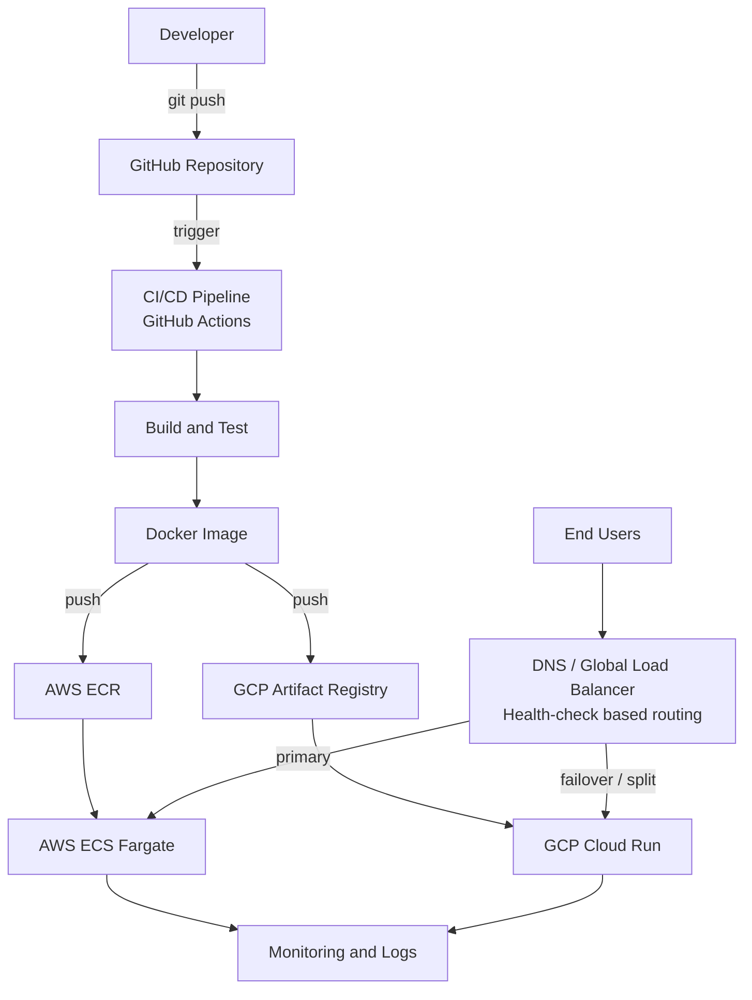

# Multi-Cloud Deployment

Deploy the same containerized application to multiple cloud providers (AWS and GCP) from a single CI/CD pipeline, with DNS-level traffic routing and failover.

> **Note:** Edit the services, tools, and paths below to match what this repository actually contains.

## Table of Contents
- [Overview](#overview)
- [Architecture](#architecture)
- [Tech Stack](#tech-stack)
- [Project Structure](#project-structure)
- [Prerequisites](#prerequisites)
- [Getting Started](#getting-started)
- [CI/CD Pipeline](#cicd-pipeline)
- [Configuration](#configuration)
- [Cleanup](#cleanup)
- [Contributing](#contributing)
- [License](#license)

## Overview

This project demonstrates a multi-cloud deployment strategy that provides:

- **Resilience**: no single cloud provider is a single point of failure
- **Portability**: one Docker image runs identically on every provider
- **Automation**: one pipeline builds, tests, and deploys to all targets
- **Flexibility**: avoid vendor lock-in and use the best service from each cloud

## Architecture



### Components

| Layer | Component | Purpose |
|---|---|---|
| Source | GitHub | Version control and pipeline trigger |
| CI/CD | GitHub Actions | Build, test, push image, deploy to each cloud |
| Packaging | Docker | Portable, identical runtime across clouds |
| Registry | AWS ECR / GCP Artifact Registry | Per-cloud image storage |
| Compute (AWS) | ECS Fargate | Serverless container hosting |
| Compute (GCP) | Cloud Run | Serverless container hosting |
| Traffic | DNS / Load balancer | Routes users, fails over on health-check failure |
| IaC | Terraform | Reproducible infrastructure on both clouds |
| Observability | CloudWatch / Cloud Logging | Logs and metrics per provider |

### Deployment Flow

1. A developer pushes code to the `main` branch.
2. The pipeline builds the app and runs tests.
3. A Docker image is built once and tagged with the commit SHA.
4. The image is pushed to both container registries.
5. The pipeline deploys the new image to AWS and GCP in parallel.
6. Health checks verify each deployment; DNS routes traffic only to healthy targets.

## Tech Stack

- **Application:** (e.g. Node.js / Python / Java)
- **Containers:** Docker
- **CI/CD:** GitHub Actions
- **Infrastructure as Code:** Terraform
- **Clouds:** AWS, GCP

## Project Structure

```
Multi-Cloud_Deployment/
├── app/                    # Application source code
├── Dockerfile              # Container build definition
├── terraform/
│   ├── aws/                # AWS infrastructure
│   └── gcp/                # GCP infrastructure
├── .github/
│   └── workflows/          # CI/CD pipeline definitions
└── README.md
```

## Prerequisites

- Git and Docker installed
- AWS account with CLI configured (`aws configure`)
- GCP project with `gcloud` CLI configured
- Terraform >= 1.5

## Getting Started

```bash
# 1. Clone the repository
git clone https://github.com/Sarthaki15/Multi-Cloud_Deployment.git
cd Multi-Cloud_Deployment

# 2. Build and run locally
docker build -t multi-cloud-app .
docker run -p 3000:3000 multi-cloud-app

# 3. Provision infrastructure
cd terraform/aws && terraform init && terraform apply
cd ../gcp && terraform init && terraform apply
```

## CI/CD Pipeline

The workflow in `.github/workflows/` runs on every push to `main`:

1. **Build and test**
2. **Build and push image** to ECR and Artifact Registry
3. **Deploy to AWS** (ECS Fargate)
4. **Deploy to GCP** (Cloud Run)
5. **Smoke test** both endpoints

### Required GitHub Secrets

| Secret | Description |
|---|---|
| `AWS_ACCESS_KEY_ID` | AWS credentials for deployment |
| `AWS_SECRET_ACCESS_KEY` | AWS credentials for deployment |
| `AWS_REGION` | Target AWS region |
| `GCP_PROJECT_ID` | GCP project ID |
| `GCP_SA_KEY` | GCP service account key (JSON) |
| `GCP_REGION` | Target GCP region |

## Configuration

| Variable | Description | Default |
|---|---|---|
| `PORT` | Application port | `3000` |
| `CLOUD_PROVIDER` | Set per deployment (`aws` / `gcp`) | `local` |
| `APP_VERSION` | Image tag / commit SHA | `dev` |

## Cleanup

Destroy cloud resources to avoid charges:

```bash
cd terraform/aws && terraform destroy
cd ../gcp && terraform destroy
```

## Contributing

1. Fork the repository
2. Create a feature branch (`git checkout -b feature/my-feature`)
3. Commit your changes and open a pull request

## License

This project is licensed under the MIT License.
